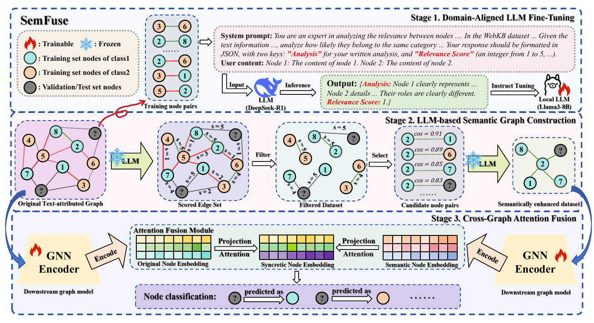

<h1 align="center">SemFuse</h1>

<p align="center">
  <strong>Aligning LLM Semantics with Graph Topology for Heterophilic Learning</strong>
  <br>
  
</p>

<p align="center">
  <strong>Zuoxiang Zhao</strong> · <strong>Shuhan Song</strong><sup>*</sup> · <strong>Yuan Zhang</strong> · <strong>Xiping Liu</strong> · <strong>Da Wang</strong> · <strong>Huawei Cao</strong>
  <br>
  <a href="https://dasfaa2026.github.io/proceedings.html"></a>
  <a href="https://www.ccf.org.cn/Academic_Evaluation/By_category/"></a>
  <a href="https://portal.core.edu.au/conf-ranks/988/"></a>
  <br>
  <a href="https://www.python.org/"></a>
  <a href="https://pytorch.org/"></a>
  <a href="https://github.com/hiyouga/LLaMA-Factory"></a>
  <a href="https://github.com/vllm-project/vllm"></a>
  <br>
  <a href="https://doi.org/10.1007/978-981-92-0375-8_20"><strong>📄 Paper</strong></a> ·
  <a href="#method"><strong>🧠 Method</strong></a> ·
  <a href="#experiments"><strong>📊 Experiments</strong></a> ·
  <a href="#quick-start"><strong>🚀 Quick start</strong></a> ·
  <a href="#citation"><strong>📚 BibTeX</strong></a>
</p>

---

<a name="overview"></a>

## 🧭 Overview

**SemFuse** uses node text to improve classification on heterophilic graphs, where connected nodes often have different labels or attributes. Adding edges from text similarity alone can introduce misleading neighbors. SemFuse uses the original topology to guide semantic edge selection, then applies a two-view GNN to learn from both the original and refined graphs.

This repository accompanies the paper published at the **31st International Conference on Database Systems for Advanced Applications (DASFAA 2026)**, in Springer's *Lecture Notes in Computer Science*, volume 16539. [Springer proceedings chapter](https://doi.org/10.1007/978-981-92-0375-8_20)

<a name="method"></a>

## 🧠 Method

<p align="center">
  <a href="./images/SemFuse.png"></a>
</p>

| Stage | What happens |
| --- | --- |
| **Domain-aligned LLM fine-tuning** | Distill relevance judgments for training node pairs into a local LLM using LoRA. |
| **Semantic graph construction** | Score existing edges and remove low-scoring ones. Retrieve candidate non-edges by cosine similarity on node features, then re-score the candidates and add high-confidence edges. |
| **Two-view graph learning** | A GNN encodes the original topology and the refined graph for node classification. The paper uses cross-graph attention, and the repository includes both [attention fusion](./src/model/gnns_fuse_attention.py) and [addition fusion](./src/model/gnns_fuse_add.py). |

<a name="experiments"></a>

## 📊 Experiments

The paper reports an average **2.02% improvement in node classification accuracy** over prior state-of-the-art methods across heterophilic benchmarks. The repository provides [Actor, Amazon, Cornell, Texas, and Wisconsin graph files](./dataset), as well as an [original-graph training script](./src/model/gnns_original.py) for comparison. [Published results summary](https://doi.org/10.1007/978-981-92-0375-8_20)

<a name="quick-start"></a>

## 🚀 Quick start

### Data and environment

Run from the repository root with [Git LFS](https://git-lfs.com/) installed.

```bash
git lfs install
git lfs pull

conda create -n semfuse python=3.10 -y
conda activate semfuse
pip install -r requirements.txt
```

The [dataset archives](./dataset) contain `node_texts`, `node_features`, `node_labels`, `edges` with shape `[2, E]`, and `train_masks`, `val_masks`, and `test_masks`.

### Train or configure the LoRA adapter

If you need to train an adapter, set `MODEL_PATH` and `OUTPUT_DIR` in [`src/llm/train.sh`](./src/llm/train.sh). Run the script from the bundled LLaMA-Factory directory so its default `data/` directory resolves to the included training data.

```bash
(
  cd src/llm/llama_factory
  pip install -e .
  bash ../train.sh
)
```

Set `base_model_path` and `lora_path` in [`llm_infer.py`](./src/script/llm_infer.py) to point to the base model and adapter checkpoint.

### Refine the graph

Run the scripts below from [`src/script`](./src/script). The checked-in defaults mix Amazon and Cornell. For a Cornell run, use `Cornell` consistently and point each script's input variables to the output of the preceding step.

| Pass | Scripts in order | Output |
| --- | --- | --- |
| **Filter original edges** | `construct_edge_json.py` → `llm_infer.py` → `clean_json.py` → `del.py` | `dataset/Cornell_filtered.npz` |
| **Score and add candidate edges** | `get_similar.py` → `llm_infer.py` → `clean_json.py` → `merge_json.py` → `add.py` | `dataset/Cornell_final.npz` |

For the second pass, point `llm_infer.py` to the candidate prompts and use a separate output JSON. Update both paths in `clean_json.py` for that pass, then point `add.py` to the merged JSON produced by `merge_json.py`.

After aligning the paths for each pass, run the scripts in order.

```bash
cd src/script
python construct_edge_json.py
python llm_infer.py
python clean_json.py
python del.py
python get_similar.py
# Switch the inference and cleaning paths to the candidate-edge files.
python llm_infer.py
python clean_json.py
python merge_json.py
python add.py
cd ../..
```

### Train the two-view GNN

Run from the repository root after the final graph has been generated.

```bash
python src/model/gnns_fuse_attention.py \
  --data-orig dataset/Cornell.npz \
  --data-enhanced dataset/Cornell_final.npz \
  --model sage \
  --epochs 400 \
  --device cuda
```

Use [`gnns_fuse_add.py`](./src/model/gnns_fuse_add.py) with the same arguments for addition fusion.

## 🗂️ Repository guide

| Path | Contents |
| --- | --- |
| [`dataset/`](./dataset) | Text-attributed graph datasets stored with Git LFS. |
| [`src/llm/`](./src/llm) | LoRA training script and bundled LLaMA-Factory. |
| [`src/script/`](./src/script) | Edge prompt construction, LLM scoring, and graph refinement. |
| [`src/model/`](./src/model) | Original-graph training and the two graph fusion variants. |

<a name="citation"></a>

## 📚 Citation

```bibtex
@inproceedings{zhao2026semfuse,
  title     = {{SemFuse}: Aligning {LLM} Semantics with Graph Topology for Heterophilic Learning},
  author    = {Zuoxiang Zhao and Shuhan Song and Yuan Zhang and Xiping Liu and Da Wang and Huawei Cao},
  booktitle = {Database Systems for Advanced Applications},
  series    = {Lecture Notes in Computer Science},
  volume    = {16539},
  pages     = {322--337},
  year      = {2026},
  publisher = {Springer Nature Singapore},
  doi       = {10.1007/978-981-92-0375-8_20}
}
```

## 🙏 Acknowledgments

The LLM training stack builds on [LLaMA-Factory](https://github.com/hiyouga/LLaMA-Factory). The graph datasets come from [LLM4HeG](https://github.com/honey0219/LLM4HeG), and the prompt and method design draw on [LLM4RGNN](https://github.com/zhongjian-zhang/LLM4RGNN).
